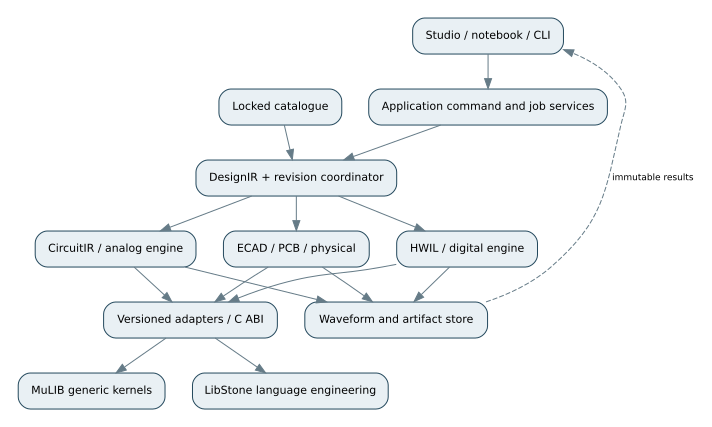

# 02 — Architecture and repository



## Layers

| Layer | Owner and interfaces |
|---|---|
| Studio | On1x UI/controller modules; native thin rendering bridge; no solver internals |
| Application services | typed commands, document model, selection, jobs, undo, notebook |
| Design kernel | Amb3r authoritative DesignIR, transactions, catalogue and dependency graph |
| Domain engines | ECAD, PCB, analog CircuitIR, HWIL, simulation, synthesis, formal, timing, physical, wave store |
| Integration | C ABI, isolated workers, MuLIB adapters, LibStone compiler/verification adapters |
| Providers | optional native renderer, SPICE model/solver, HDL, device DB, instruments, AI endpoints |

Use On1x for orchestration and domain logic as far as admitted APIs permit. Existing native C and C++ adapters are a transitional implementation substrate; do not fake generalized On1x resource bindings. Keep a native headless engine usable independently of the UI. A rough target is 60% On1x application/domain logic, 30% reusable native kernels plus adapters, 10% host/provider glue; measure and revise this, do not optimize to a line-count quota.

## Suggested repository

```text
amb3r/
  AGENTS.md  CMakeLists.txt  On1xfile  README.md
  deps/              # locks; MuLIB/LibStone submodules or reproducible external paths
  include/amb3r/      # public C ABI only
  src/{core,host,broker,transport,bindings,providers}/
  engine/{design,ecad,pcb,analog,hwil,dsim,synth,formal,timing,physical,rf,wave}/
  studio/{shell,canvas,schematic,board,wave,notebook,inspector}/
  elektra/{grammar,ast,semantic,lower,stdlib,cli}/
  on1x/{library,ppx,contracts,examples}/
  sdk/{include,src,bindings,examples,tests}/
  plugins/{builtin,examples}/
  extensions/{lua,examples}/
  ai/{gateway,retrieval,tools,eval,providers}/
  catalogues/{components,models,rules,targets,providers}/
  schemas/  tests/{unit,differential,integration,fuzz,golden}/
  docs/  tools/  packaging/
```

No application-specific additions to upstream MuLIB. If a generic kernel needs fixes, propose a separate upstream change; adapt to the pinned version in this repository. Lock both revisions and the admitted build configuration. One implementation-switch translation unit per native linkage domain; avoid duplicate symbols across plugins by using host functions or private namespaced providers. Keep ABI contracts independent of C++ layouts and On1x private ABI.

## Process and concurrency

UI thread owns draw state; transaction coordinator serializes model publication. Jobs execute on immutable snapshots via task pools or worker processes; a job has input digest, cancellation, deadline, budget, deterministic seed and output staging directory. Solver may parallelize independent sweep points. Do not assume On1x cooperative tasks create native parallelism. Never pass live model pointers to a worker. Isolated native extensions receive framed messages and sealed immutable snapshots, not the UI process heap. Trusted code may access host ABI functions under explicit grant. Resource ownership is host-validated.

## Technology decisions

- Headless engine: C11 ABI, C/C++20 internal host where necessary; On1x controller and library code as interfaces mature.
- UI: evaluate existing ImmGTK/GLX and native providers; use ImGui/ImPlot as optional initial implementation if faster. No assumption that header names imply full desktop/GPU providers.
- Persistence: filesystem project plus content-addressed blobs and journal; an embedded DB provider (SQLite or a suitable MuLIB KV) for indices, not the semantic identity.
- Parsing: Elektra grammar and canonical AST, optionally generated using LibStone/Firestone. Use compiler frontends rather than asking PPXs to implement unrelated full language semantics.
- Simulation: reference dense MNA initially, sparse assembly/solver interfaces later. Optional KLU/IDA/model adapters must not alter stated numerical semantics silently.

## Build and deploy

`amb3r` GUI, `amb3rctl` headless, `elektrac` language compiler, `amb3r-worker` trusted bootstrap, `amb3r-sdk` developer utility. CMake exports `Amb3r::SDK` and `Amb3r::Engine` with explicit shared/static profiles. On1xfile builds pinned application modules and native bridge; if its current toolchain cannot do an operation, CMake handles the boundary until support matures. Package definitions specify platform, schema, ABI, provider capabilities and license. No runtime downloads without explicit user action. Separate debug symbols, deterministic manifests, versioned serialization, offline test mode.
