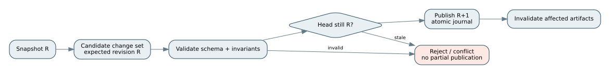

# 03 — Design database, catalogue and IR lineage

## Identity model

Use persistent UUIDs (128-bit) for documents, component instances, ports, nets, pins, board features, constraints and library identities. References combine object kind and UUID. In memory use generation-checked handle slots tied to a snapshot. Solver/elaboration IDs are dense integers mapped back to source objects; never serialize them as permanent identities. Hierarchical identity is instance path + definition/object ID; flattened identities retain provenance. A revision ID addresses a canonical manifest of immutable objects and catalogue locks, not the current clock time.

| Object | Key fields |
|---|---|
| ComponentDefinition | revision, logical pin map, symbol, footprint variants, models, datasheet provenance, ratings |
| Instance | def revision, name, parameters, symbol placements, logical pin bindings, attributes |
| Net | scoped name, connectivity endpoints, class, discipline, global/explicit alias marker |
| Constraint | stable ID, scope, rule identifier/version, units, severity, exception/waiver provenance |
| Board | layer stackup, shapes in integer database units, placements, pads, vias, tracks, zones |
| SimulationSpec | elaboration parameters, solver profile, stimuli, analysis and probe IDs |
| Result | revision, IR digest, provider/model versions, units, status, chunk refs, warnings |

Use integer nanometres for planar geometry by default with checked arithmetic, affine transforms and separately tagged display coordinates. Store SI physical quantities with dimensions; preserve exact rational/decimal input until numerical lowering. Node 0 is ground in SPICE adapters; the new CircuitIR uses a distinct reserved ground ID. Adapter must translate explicitly.

## Transaction protocol

1. Read snapshot revision R and declare a bounded changeset with expected object versions.
2. Validate schema, scope, UUIDs, capabilities, referenced objects and preconditions.
3. Apply changes to an isolated candidate; rebuild impacted derived connectivity and validate hard invariants.
4. Run appropriate ERC/DRC/semantic checks; differentiate hard invariants from policy violations. A user may explicitly accept a nonfatal rule warning but not corrupt identity/ownership rules.
5. Publish atomically if head still R; otherwise reject as stale or perform an explicit three-way merge with conflict report.
6. Append journal entry, update indexes and invalidate dependent cached artifacts. Undo is a new inverse transaction, not a rewind of shared history.

Crash sequence: write blobs, fsync when configured, write temporary manifest then atomic rename, journal with commit marker and recovery checks; never reveal inconsistent half-revisions. Use path confinement and length caps. Handle external file change as a candidate import. Autosave branches recover without overwriting committed history.

## Catalogue-driven design

Registry records are declarative descriptions; executable registrations require separate authority. Catalogue kinds: component, symbol, footprint, spice model, HDL primitive, standard cell, FPGA target, material, rule, solver, analysis, rewrite pass, importer/exporter, instrument, AI provider and PPX. Dependency locks include licence, digest, target, capability and provenance. Use MuLIB CDD for small bounded resolution, hierarchical domain partitioning and deterministic topological planning at scale. Reject cycles, missing provider, ambiguous versions, incompatible capabilities. A catalogue entry does not establish callability or safety.

## On-disk format proposal

`project.amb3r.json` (schema 1), `objects/<digest>.json`, `assets/<sha256>`, `catalogue.lock.json`, `refs/heads/main`, `journal/`, `results/<run-id>/manifest.json`. Large arrays use versioned length-checked binary blobs (little-endian, element type, dimensions, chunk hash); not raw C structure dumps. Canonical hash: UTF-8 canonical JSON with defined number policy (exact dimensions as strings, finite numbers only), deterministic key/array ordering where semantic sets require it. Use a documented canonicalization algorithm such as RFC 8785 where applicable. Schema migration is read-old/write-new with explicit confirmation and backup. Unknown versions reject rather than silently downgrade.

See [project schema](../schemas/project.schema.json), [changeset schema](../schemas/changeset.schema.json). These schemas are structural drafts; cross-object identity, units and semantic validation are host obligations.
