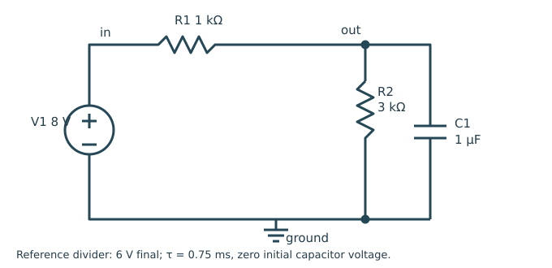

# 04 — ECAD and PCB

## Schematic and connectivity

A symbol is a rendering of a component definition, not its electrical implementation. Separate pin designators, electrical type, logical pin identity, pin swapping, hidden units and power pins. An instance binds a library revision and optional parameter set. Flatten hierarchy only after checking port widths, directions, instance recursion, buses, aliases, global power nets and variant selection.

Build net equivalence classes from explicit endpoints, junctions and label scope; crossing wires do not connect without an explicit junction or rule. Incrementally update connectivity on touched sheets; a full reconstruction is a differential oracle. Maintain mappings from net IDs to schematic segments, pads, simulation node IDs and waveform probes. ERC rule examples: undriven inputs, multiple push-pull drivers, missing supply, incompatible voltage domain, unconnected mandatory pins, bus width mismatch, missing footprint pin mapping. Distinguish passive, power input/output, open drain, bidirectional and unknown type.

## PCB model

Board coordinates integer database units. Layers and dielectric stackup have stable IDs; every track/via/pad/zone belongs to a layer set and logical net. Footprints have local coordinates, courtyard, fabrication, assembly, padstack and optional 3D reference. Maintain explicit mirrored transforms and pin-to-pad mapping. Import changes from schematic via a transaction diff: new footprints, removed pins, net changes, unresolved assignments. Never silently drop routing.

Pipeline: outline → placements → ratsnest → routing constraints → routing/pouring → DRC → fabrication staging → independent review. Start with Manhattan A* track routing over a grid with clearance inflation, then exact geometric clearance, push-and-shove, differential pairs, length matching, via costs, impedance and thermal relief. All routing proposals get full geometric validation; a grid result alone cannot prove continuous design-rule compliance.

DRC rules: copper clearance by netclass and layer; board-edge distance; pad annular ring; drill size and stackup compatibility; mask slivers; short/open detection; solder paste; courtyard overlap; keepouts; differential skew; return-path and high-speed rules explicitly heuristic unless field verified. Multi-layer connectivity uses pad/via layer transitions. Spatial indexes accelerate candidate selection but exact predicates own correctness.

## Manufacturing and exchange

Stage Gerber, Excellon, BOM, centroid/pick-and-place, assembly drawings, IPC-2581 where actually implemented, and STEP via provider if supported. Validate unit conversion, origins, apertures, polarity, drill tool definitions and cross-file coordinates. Bounded MuLIB format kernels are not full format implementations. Preserve unknown fields on roundtrip or report lossy import. Use KiCad format versions explicitly and optional real KiCad batch validation. Never mark fabrication ready without rule results, stackup review, tolerances and explicit approval.

## Kernel integration path

`eda-store`/`eda-transaction`/`eda-netgraph` → `ecad-symbol`/`ecad-instance`/`ecad-connect`/`ecad-elaborate` → `pcb-footprint`, `pcb-pad`, `pcb-via`, `pcb-board`, `pcb-spatial` → `pcb-drc`, `pcb-router`, `pcb-pour` → export. All names abbreviate `mulib-...h`. Some implementations have different object models and bounds; use the workbook kernel ledger, checked ownership adapters and a single application DesignIR. Do not assume these APIs compose directly.

## Acceptance

Golden hierarchical schematic; deliberate nonconnecting crossing; bus mismatch; incremental and full connectivity parity; footprint swap with retained IDs; exact clearance cases incl tangent policy; netlist-to-board mapping; undo/redo and stale transaction; roundtrip exchange with loss report; fabrication output verified by independent parser. PCB GUI is a view onto this model, not a separate store.
