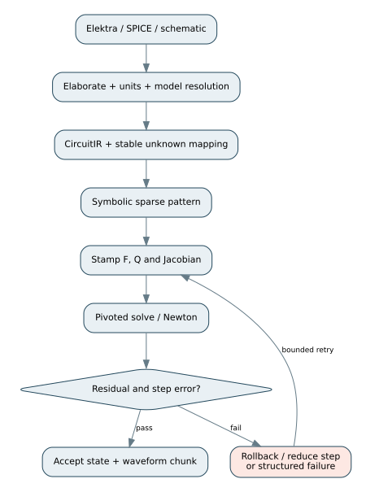
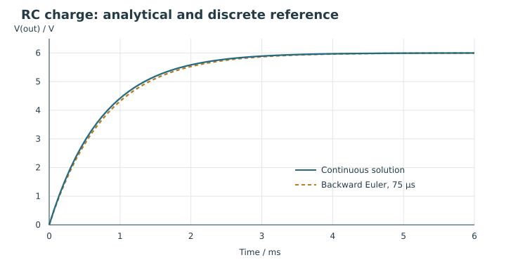

# 05 — Analog simulation engine

Build an original simulator, not just a UI around an external SPICE executable. Optional external simulators are reference providers. CircuitIR is independent of deck syntax and DesignIR, retaining stable component IDs and dense unknown mappings.

## Elaboration

Parse SPICE or Elektra → parameter evaluation with dimensional checking → resolve libraries/models and hierarchical subcircuits → flatten with provenance → allocate node-voltage and branch-current unknowns → build sparse pattern → numerical assembly. Reject inconsistent units, unknown device, recursive subcircuit, unsupported behavioral expression or missing reference node. Distinguish ideal voltage constraints from conductive branches; current source direction positive a→b. Voltage source imposes V(a)-V(b)=E; its branch current is positive a→b.

For linear MNA, `G x + C dx/dt = b(t)` with algebraic branch equations. Conductance g between a,b contributes +g to both diagonals and -g to off-diagonals, omitting ground. A current source a→b subtracts I from RHS(a), adds I to RHS(b). An ideal voltage source introduces a branch unknown with incidence ±1 and a constraint row. Inductor current contributes incidence and `V(a)-V(b)-L di/dt=0`. Capacitor charge contributes the derivative term. A sparse-tableau alternative introduces every branch current and voltage explicitly with KCL, KVL and constitutive equations; use it as a reference engine or for special topologies, not an implicit fallback.

Nonlinear DAE: `F(x,t) + dQ(x,t)/dt = 0`. Backward Euler residual `R=F(x_n,t_n)+(Q(x_n)-Q(x_prev))/h`; Jacobian `J=∂F/∂x + (1/h)∂Q/∂x`. Solve `J Δx=-R`, update with damping and check scaled residual and update norms. Device evaluator returns current/charge, analytic derivatives or a validated autodiff path. Use finite difference to verify derivatives, not as default production path. Limit exponentials with model-specific continuous limiting, document temperature and sign conventions. Detect singular matrices and failed progress; source stepping/gmin stepping are explicit recovery stages with final residual at original equations. Never silently publish an unconverged solve.

## Analysis profiles

| Analysis | Method and caveat |
|---|---|
| OP/DC | solve steady-state F; sweep with warm start and independent fallback; report branch solutions |
| AC | linearize around converged OP, solve `(J_F+jωJ_Q)x=b_ac`; phase/magnitude and units |
| Transient | BE reference, trapezoid and variable order BDF later; local error, breakpoints, rollback rejected steps, consistent initial conditions |
| Noise | device noise spectra, transfer/adjoint calculation and covariance where supported; neither noise header nor FFT proves full noise model |
| Sensitivity | direct/adjoint derivative, finite-difference oracle; disclose discontinuities |
| Monte Carlo | explicit distributions, correlations, locked seed and reproducible draws |
| Sweep/optimization | immutable run specs, bounded solver budgets, constraints, failure-valued samples |
| PZ and Fourier | generalized eigenvalue and windowed/sampled spectra; identify aliasing and model assumptions |

Adaptive time loop: predict → stamp → Newton → estimate error → accept or rollback → update step; clamp to declared breakpoints, minimum/maximum step and iteration limits. Preserve previous state on all rejected steps; only accepted time samples enter waveform result. Never average away failure. Scaling and ordering matter; use COO/CSR assembly with symbolic pattern reuse, fill reducing ordering and cache validity keyed by topology and model version. Refactor numerical values when pattern unchanged. Add residual/refinement and conditioning diagnostics. Dense pivoted reference remains an oracle on small circuits. Existing sparse LU is a row-based reference, not a high-performance production factorization.

## Device provider contract

`describe`: typed terminal disciplines, parameters/defaults/ranges/units, state layout, model revision and supported analyses. `elaborate`: allocate unknowns/state and publish structural sparsity. `evaluate`: given bounded immutable local view and time/history, return residual/charge/Jacobian stamps; no topology or external I/O inside Newton. `checkpoint/restore/accept`: state rollback and commit. `destroy`: explicit resource release. For high frequency per-device stamp calls, trusted in-process compiled providers or batched isolated calls; do not IPC/RPC per scalar stamp. External compact models via explicitly versioned OSDI/OpenVAF or other model provider after licence and ABI review. Static level-1 NMOS is not BSIM, and simple BJT/JFET kernels are limited.

## Waveforms and results

Chunk series by run/signal; analog floating timestamps accepted monotonically, digital integer ticks separately; attach units, clock, interpolation and discontinuity semantics. Store min/max envelope pyramids for plotting without hiding spikes. RMS definition must distinguish sample RMS and time-integrated RMS. Measurements include crossing direction, threshold, hysteresis, window and status. Full-resolution data remains authoritative. Export CSV/VCD only for applicable domains; FST wrapper is not assumed standard-compliant.

## Reference exercise

8 V through 1 kΩ to output, 3 kΩ to ground, 1 µF to ground. `V∞=6 V`, `Rth=750 Ω`, `τ=0.75 ms`. Starting capacitor at 0, BE h=75 µs gives `v_n=6(1-(10/11)^n)`. Continuous reference `6(1-e^(-t/τ))`. See C and SPICE examples; do not compare simulator default steady-state initialization with zero initial-capacitor trace without matching options. Additional tests: floating singular network, RC AC pole, RLC energy/damping, diode derivative and sweep, temperature, ill-conditioned networks and failure rollback.

`examples/rc-reference.csv` contains the 81 independently evaluated formula points, not actual simulator output.
