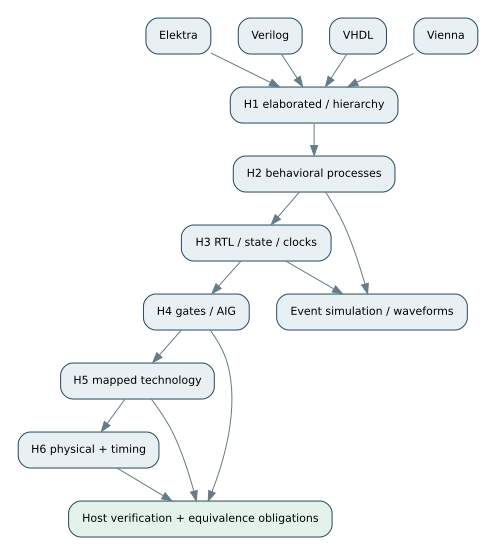

# 06 — HWIL: hardware intermediate language



HWIL is the common hardware compiler representation for Elektra hardware, Verilog, VHDL and Vienna ADL. Vienna is an extensible architecture-description input (instruction encodings, resources, microarchitectural units and scheduling constraints); it is not assumed to be an existing standardized parser. On1x compiler MIR is software IR, not a substitute for HWIL.

## Levels and verifier gates

| Level | Representation | Invariants |
|---|---|---|
| H0 source | AST, tokens/spans, macros/packages | syntax and scopes |
| H1 elaborated | modules, parameter values, instance graph | finite hierarchy, port matching, constant generate |
| H2 behavioral | processes, events, sensitivity, assignments | explicit scheduling semantics; supported constructs |
| H3 RTL | typed wires, comb operations, registers, memories | complete assignments, width/signedness, clocks/resets, no unbroken comb cycle |
| H4 gates | bit-blasted AIG/XAG/MIG or cell-independent logic | bit order, state mapping, X policy |
| H5 technology | library cells, LUTs, mapped registers | legal pins, timing arcs, equivalence obligations |
| H6 physical | location, routing, parasitics and timing graph | technology-specific constraints; placement/routing consistency |

Types: `logic<N,4>` or `bits<N,2>`; signedness separate; arrays and packed vectors have explicit ordering; clocks and resets are structured metadata; memory ports define latency, read-during-write policy and collision behavior. Registers define edge, enable, reset kind and reset value. Combinational ops have single definitions (SSA-like within a region), wires may have explicit resolved drivers; sequential feedback is legal through state, combinational cycle is error unless a declared simulation-only resolved model supports it. Four-state simulation must not be optimized by two-state equivalence assumptions without explicit proof or profile conversion.

```text
hwil.module @counter(%clk: clock, %rst: logic<1,4>) -> (%q: bits<8,2>) {
  %q = reg bits<8,2> clock %clk reset sync_high %rst init 0
  %next = add.wrap %q, const 1 : bits<8,2>
  reg.next %q, %next
}
```

Proposed textual design, not existing MuLIB syntax. Use versioned binary/JSON or textual interchange with bounded decoding, stable source IDs and verified publication. A pass declares input/output level, required analyses, preserved facts and proof obligations. Candidate rewrite is not verified or equivalent merely because well formed. Use CEC/SEC according to state mapping and property scope.

## Frontends and Vienna

Verilog initial profile: modules, parameters, assign, combinational blocks with explicit complete assignment, edge-triggered registers and limited generate. VHDL initial entities/architectures, std_logic/vector, signal assignments and clocked processes; handle delta semantics explicitly. SystemVerilog assertions, packages, advanced event regions and full language are future profiles. Vienna proposed example: describe ALU operation and resource latency/occupancy plus encodings, lower behavior into HWIL and schedule constraints into a distinct machine model. Never equate an encoding with an actual hardware implementation.

## Adapter plan

Legacy `hwil-module` is bounded single-bit; newer `hwil-context` uses independent node representations and widths 1–64. Introduce application-owned versioned HWIL and lower only admitted slices to those kernels. Migrate to multiword bitvectors for arbitrary width. Reuse LibStone for parser generation, e-graphs, SAT/SMT, relational analysis and rewriting only when actual interfaces/semantics match. Preserve source mappings from each level. Backend exports: HWIL text, Verilog subset, JSON netlists, VCD simulation traces, technology artifacts via providers. Native FPGA bitstream requires actual device database and vendor-format verification.
