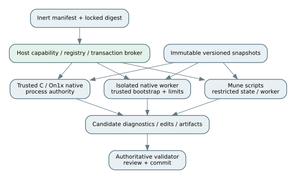

# 10 — Extensibility system

Amb3r has three primary extension surfaces: a C SDK for native providers, Lua-language extension scripts through MuLIB Mune, and On1x-authored plugins. All three share an application-level semantic registry, capability broker, diagnostic and transaction protocol. On1x compiler SDK extensions are a separate build-time concern; do not conflate them with Amb3r application plugins.

## Plugin facets

Commands; read-only analyses; rule packs (ERC/DRC/DFM/CDC); netlist import/export; editor widgets and inspectors; catalogue providers; device models; matrix solvers; simulation analyses; waveform transforms; synthesis/optimization passes; formal engines; timing/physical providers; FPGA architectures; SCPI instruments; notebook cell evaluators; AI adapters and tools; Elektra frontend libraries. `catalogues/extensions.csv` records inputs, outputs and privilege levels. Start with read-only command and rule facets.

## Native SDK architecture

Public C11 ABI (`sdk/include/amb3r_sdk.h` is an executable reference ABI subset, not frozen production ABI). ABI and protocol version independently. Descriptor records start with `abi_version, struct_size`; host checks size, rejects unknown mandatory features. Explicit entry `amb3r_plugin_entry_v1`; loader never trusts plugin-reported safety. Host table uses opaque context and fixed-width status, length-aware strings, generation-checked integer handles, explicit buffer allocator ownership, typed snapshots, cancellation and diagnostic callbacks. No STL, C++ exceptions or raw compiler pointers in ABI. Native plugins must not export MuLIB implementations into a competing global symbol domain.

Lifecycle: discover inert manifest → resolve dependencies → validate digest, target and ABI → select trust profile → authorize required capabilities → load → validate descriptor → initialize → transactional registration → invoke → cancel/drain → unregister → destroy → unload. Partial failure compensates in reverse order. Reject unloading while callbacks or live dependent resources remain. No callback may retain borrowed snapshot/span beyond call unless an explicit retained handle is returned. All outputs staged until success; diagnostics bounded; handles scoped to host, kind, generation, revision. Registry is deterministic, namespaced, no builtin shadowing; duplicate ID rejects. A plugin facet accepts immutable snapshot and returns candidate changeset or typed artifact. Only host publishes.

## Isolation profiles

| Profile | Scope |
|---|---|
| Builtin/trusted linked | reviewed hot device stamps, renderer, numeric kernels; executes process authority |
| Trusted native dynamic | authorized digest, dependency trust and version checks; still unrestricted native code |
| Isolated worker | trusted bootstrap first, OS confinement before untrusted DSO constructors, broker-only requests, fail closed |
| Mune interpreted | restricted globals, native functions allowlisted, limits, worker for untrusted code |
| On1x | compiled trusted modules or isolated native worker; no claim On1x implies sandbox |
| Future WASM | separate explicit engine and host capability enforcement |

MuLIB sandbox-process requires trusted bootstrap; do not launch arbitrary untrusted ELF assuming filter before startup. On1xRT sealed image authorizes trusted code only, not dependency integrity or isolation. Worker bootstrap uses namespace/seccomp, cgroup and Landlock only when actual supported and appropriate; no silent downgrade. Use framed IPC, limits, request IDs, cancellation, deadline, protocol version, structured errors and monotonic sequence. Control plane handles requests/diagnostics; data plane immutable sealed buffers with length, digest, schema, revision and read-only mapping. On other OS, explicit unsupported or independently reviewed equivalent. Worker receives no arbitrary file paths, credentials, sockets, process creation or direct database writes. Provider outputs untrusted and validated.

## Mune Lua extensions

Mune is MuLIB's independent Lua runtime and language toolchain, not upstream Lua C API. Verify supported language/libraries against pinned revision. Use `mulib_mune_state_create` and the actual embed API, configure limits and native bindings; create an extension state per trust/domain, opt out of file/network/dynamic-code facilities unless brokered. Disable JIT/AOT/native loaders for untrusted packages; run in isolated worker where enforcement is uncertain. Expose a small module `amb3r`: `command`, `rule`, `snapshot`, `objects`, `emit`, `propose`, `job`, `cancel`, `log`. None exist upstream; they are Amb3r-owned adapters. Script arguments and results are JSON-like typed values (IDs as strings, not Lua numeric pointers or 64-bit integer coercion). Expose bounded iterator pages and no arbitrary DB access. See example Lua policy. Verify Mune syntax/subset before release; fail closed when unsupported.

## On1x plugin path

1. Author using `amb3r-sdk` On1x package (proposed), application-owned Exotract/ExoML contracts and reviewed wrappers.
2. Compile with canonical on1xc to admitted C11 profile; explicit generated C adapter implements plugin descriptor. Never assume the proposed `--emit-runtime-module` or ABI-2 dynamic CLI exists.
3. For current scalar-only bridge, restricted trusted profile; for resource plugins wait for reviewed owner/borrow/aggregate lowering. Use On1xRT authorized native loading only where compatible descriptor can be provided and actual platform supported.
4. Future generic plugin authoring includes generated module exports, owned handles, structured callbacks and worker transport. Same capability model as C/Lua.

## Package and SDK tooling

`amb3r-sdk init/build/test/package/inspect/install/disable/remove/doctor/abi-check` (proposed). Package contains manifest, signed digest metadata, immutable platform artifact, docs, optional schemas and licence. Trust grants stored separately from package. Install never runs code; activation requires explicit policy. Semver for plugin/API with capability negotiation; schema and protocol versions independent. Lock exact dependencies. Do not rely on plugin signatures as proof of safety. Hot reload starts new instance after drain, does not mutate live native code. Quarantine repeatedly failing providers. Test fixture malicious IPC lengths, stale handles, denied capabilities, timeouts, duplicate registry keys, reentry, native loader failure and cancellation.
