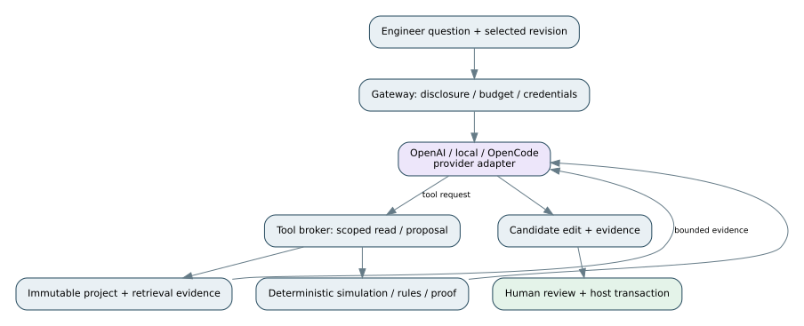

# 12 — AI-assisted EDA: Amb3r Copilot and local engineering models

## Design objective

AI is an optional adviser and candidate generator. Deterministic engineering tools own numerical results, connectivity, rule checks, simulation, proof and changeset publication. A model can explain, search, suggest and generate a plan; it cannot certify a circuit, approve a foreign contract, silently edit a PCB, upload private PDKs, run arbitrary shell commands or control live hardware. AI can be disabled without affecting any core workflow.

## Capabilities

- Ask why a signal oscillates, why ERC fires, how an RC cutoff changes, what a timing path means; cite exact design revision, library/datasheet page and tool results.
- Generate candidate Elektra/SPICE/HWIL/testbench source, parameter sweeps, symbolic explanations and rule fixes; validate and show semantic diff.
- Guided part selection using actual catalogue availability/rating/footprint data; no invented part specifications; human approval for procurement.
- Optimize within explicit constraints using real deterministic search (sweep, gradient, Bayesian optimization or evolutions) with model suggestions only as candidate priors. Keep best verified result, failed sample and seed.
- Diagnose singular matrices, convergence issues, missing resets, CDC warnings, netlist mismatches and proof counterexamples using tool evidence.
- Notebook assistant: explain plots, produce reproducible recipes, generate reports, cite measurements and assumptions.

## Provider architecture

`AiGateway` owns credential store, network policy, per-project disclosure rules, token/cost ceilings, model capability catalogue and cancellation. `Provider` interface: discover capabilities, submit normalized request, stream typed events, cancel, report usage/errors. `ToolBroker` exposes a limited versioned tool set. `Retrieval` supplies immutable evidence with IDs/digests and citations. `ProposalValidator` parses candidate Elektra/changesets, checks design revision and constraints, runs approved tests, produces review diff. No provider directly receives DB pointers, secret values or a generic filesystem tool.

| Protocol | Use | Boundary |
|---|---|---|
| OpenAI Responses API | hosted model, function calls, structured output, streaming | documented API; model ID configurable, host executes tools |
| OpenAI-compatible Chat Completions | inference servers that implement subset | distinguish request/tool schemas, do not assume full compatibility |
| OpenCode HTTP API / SDK | optional agent-oriented reviewer/generator session | use documented versioned server/client API, restricted workspace and permissions |
| MCP | standard resource/tool exposure to compatible external agents | protocol version negotiation, explicit authorization, tool grants enforced by host |
| Ollama / llama.cpp / vLLM | local model via supported API profile | feature probe, no implicit remote fallback |
| Other providers | Anthropic Messages, Gemini, custom enterprise adapters | normalized events and capability-specific translation |

OpenAI Responses and Chat Completions are different APIs. OpenCode is an agent harness with its own HTTP/session/event API, not another spelling of OpenAI inference. Its experimental HTTP surface is version-dependent; use generated OpenAPI client or published SDK; confirm installed version before hardcoding endpoint schemas. See references. Do not reuse OAuth tokens from unrelated apps or scrape private authentication. Use user-supplied authorized credentials in OS keyring; never persist keys in project files or logs.

## Responses flow

POST `https://api.openai.com/v1/responses` over TLS with explicit model, input and function-tool schemas. Response output items may request a tool call; validate name, arguments, revision, grant and budgets; return `function_call_output` with matching `call_id` to the model through the documented continuation mechanism. Treat stream fragments as incomplete until item completion; parse bounded SSE, handle cancellation, tool-call failures, timeouts, rate limits, retry with idempotency policy, and record usage. For privacy prefer stateless client-side context and `store:false` where model/API supports it; verify provider retention and organization policy independently. No API key embedded in example. Files `examples/ai/` show mock request and output envelope. Model output does not authorize operations.

Chat Completions translation uses `messages`, nested function tools and tool-role messages keyed by tool call ID; do not send Responses `input` objects unchanged. Local compatibility may implement some but not all fields. Explicit endpoint allowlist, TLS/cert verification for remote hosts, loopback binding for local models, no fallback to cloud. Probe streaming, tool calls, JSON schema and context size. Model-specific capabilities versioned.

## OpenCode integration

Use OpenCode as a separate constrained agent process/service to propose Elektra generators, rules, patches or analysis recipes. Current documented API includes `/api/info` and `POST /api/session/{sessionID}/prompt`; API is experimental and installed versions differ. Use `@opencode/client` for HTTP or an SDK sidecar for a pinned supported interface, discover its OpenAPI, and adapt session creation, prompt, events and cancellation. Avoid embedding a general shell/code-write agent in the engine process. Export only a sanitized temporary workspace with immutable snapshot and proposed-output directory. Deny shell/network/write outside that directory by actual OS policy; agent UI permission prompts alone are not a sandbox. Review output as a changeset or source diff; compile and validate with independent tools before applying. Never let the harness install packages or alter production design without separate explicit authorization.

## MCP tool surface

Offer small read-only tools first: `design.get_revision`, `design.query_objects`, `catalogue.lookup`, `analysis.explain_diagnostic`, `wave.measure`, `simulation.preview`, `formal.explain_counterexample`. Distinguish expensive analysis launches (`jobs.run`) and proposal creation (`design.propose`) from publication (`design.apply` — never exposed to agent by default). All return revision, bounded results and structured evidence. MCP tool annotations are hints; enforce scopes and budgets. HTTP transport uses negotiated spec, authentication, audience/issuer checks, Origin validation where applicable, and no reusable bearer forwarding. Local stdio server gets scoped host transport; never inherits unrestricted project capabilities.

## RAG and local specialized model

Build indexed chunks from user-owned datasheets, model docs, design rules, project history, simulation evidence, Elektra/HWIL docs, validated examples and licensed EDA references. Store title, page/section, revision, licence and digest. Hybrid BM25 and vector search plus domain filtering/rerank; retrieve only authorized project snippets. Never treat untrusted datasheet/imported source content as instructions. Citation validation checks that referenced ID/page exists and supports the claim. Model may answer insufficient evidence. Local inference first; start with an instruction model in supported 7–14B class where hardware allows, evaluate rather than assume quality; use quantization with measured numerical reliability and context budget. Separate embedding/rerank models from generation. Fine-tuning optional: licensed validated examples with tool traces, units and counterexamples, split by design families to prevent leakage. Prefer retrieval and deterministic solver use over training for exact facts. Never upload private designs or credentials without explicit disclosure approval.

## Evaluation

Golden benchmark tasks: identify disconnected pin; explain resistor divider; calculate units; predict RC with solver evidence; identify X propagation; translate bounded HDL; spot DRC conflict; generate a syntactically admitted changeset; refuse stale snapshot; handle malicious retrieved prompt; refuse dangerous instrument command. Metrics: tool correctness, numerical relative error, schema validity, citation precision, unsupported feature honesty, testbench/simulation pass, false claim rate, privacy leak rate, latency and cost. A proposed design edit passes deterministic checks and user review; agent reasoning is not proof. Local or hosted model may fail; deterministic engine is usable independently. Safety-critical/high-voltage/power designs require qualified engineering review.
