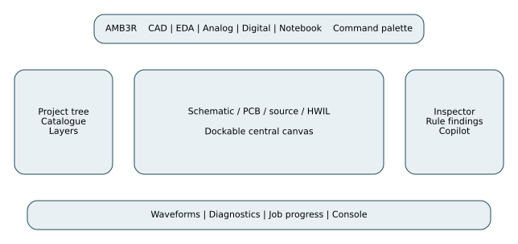

# 13 — Studio, notebook and CLI



Studio uses immediate-mode UI initially (ImmGTK/GLX where mature, optional ImGui/ImPlot adapter). Main frame: project tree and catalogue left; dockable schematic/PCB/HWIL/source/notebook canvas center; inspector/rules/AI right; waveform/diagnostic/job timeline bottom. Every document view subscribes to immutable model revisions. Cross-probe by stable ID: clicking a component highlights footprint, netlist node, related waveform and diagnostic. Stable UI IDs from document/entity, not address. A single action dispatcher supports keyboard, menu, palette, CLI, script and plugin.

Canvas: camera transforms, grid/snap, integer model coordinates, hit test and selection, layer visibility, LOD/tile cache, text measurement and font shaping provider, drawlist, undoable edits formed only on accepted gestures. Preview rubber band not committed until transaction. Handle drag cancellation and multi-selection. Do not draw from mutable solver state. Plot analog sample envelopes and digital steps, dual cursor, units-aware transforms, threshold markers, linked time axes. Keep complete waveform for measurements while reducing display data. Accessibility: keyboard navigation, readable contrast, separate X/Z markers from colour, text alternative to plot/diagnostics.

Notebook cells: Markdown, Elektra, On1x, Lua/Mune, SPICE, HDL, command recipes, plots and data views; executable cells form explicit dependency DAG. Snapshot inputs plus parameter hashes, deterministic outputs, stale flags; rerun only after user request or configured policy. Cells cannot mutate design except explicit candidate transaction command. REPL state distinguish ephemeral from reproducible notebook state. Attach run artifact manifests. AI generated cells are proposals; no autoexecution.

## Proposed CLI

```sh
amb3rctl init filter
amb3rctl design validate project.amb3r.json
amb3rctl netlist export --format spice --out filter.cir
amb3rctl simulate --analysis op --revision HEAD --json
amb3rctl simulate --recipe rc_charge --out results/
amb3rctl hwil compile counter.elek --level rtl -o counter.hwil
amb3rctl synth counter.hwil --pipeline area --out mapped.hwil
amb3rctl verify equivalence before.hwil mapped.hwil --assumptions reset.json
amb3rctl pcb drc --rules default --json
amb3rctl plugin inspect plugin.json
amb3rctl reproduce results/run/manifest.json
amb3rctl ai ask --local --revision HEAD 'Explain diagnostic ERC-001'
```

Exit codes proposal: 0 complete success; 2 invalid input/config; 3 rule violations or counterexample; 4 unsupported; 5 numerical failure; 6 stale revision; 7 denied capability; 8 limit/cancel; 9 internal error. Structured diagnostics go stderr, JSON artifacts stdout or atomic path, no mixed progress text. Deterministic output mode, no network unless explicitly authorized. UI shares commands and report schema. CLI strings above not implemented by workbook.
